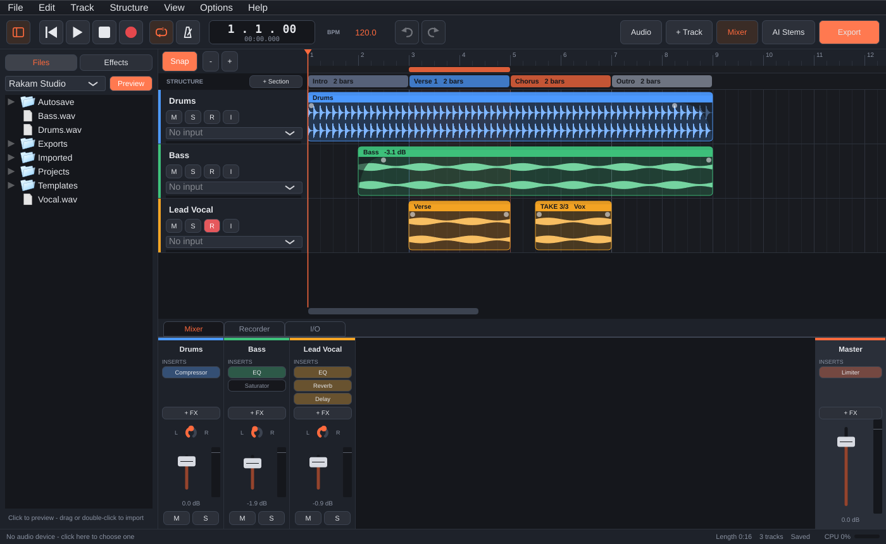
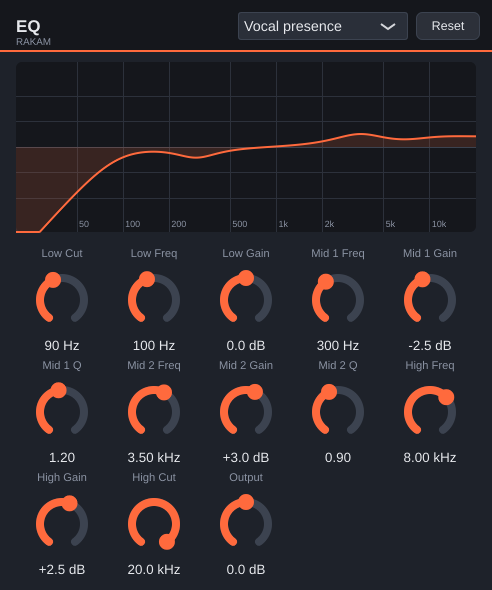
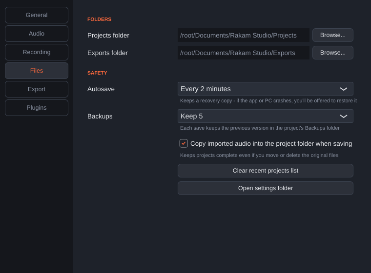
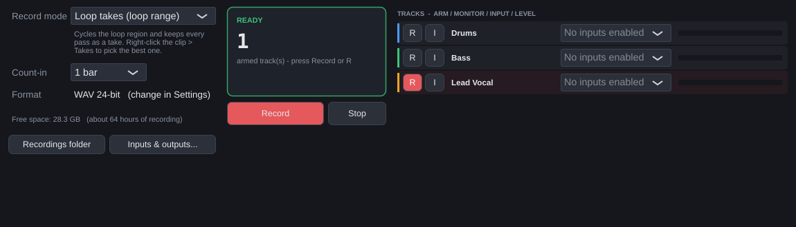
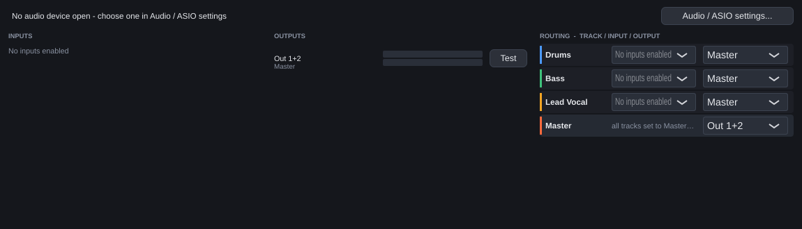

# Rakam Studio

A multitrack DAW for Windows with ASIO, VST3 effects and a mixer — built around one idea:
**getting your mix out**. Export the full mix and every track as perfectly aligned stems,
pack the whole project into one zip for another studio, or split any finished song into
vocals / drums / bass / other with AI.

## Features

| Area | What you get |
|---|---|
| Audio drivers | **ASIO** (lowest latency), WASAPI, DirectSound. First launch picks ASIO automatically if a driver is installed |
| **Recorder** | Multitrack recording from any input (mono or stereo pairs), 4 record modes - **Normal**, **Replace**, **Punch in/out** (with pre-roll) and **Loop takes** (every pass kept, pick the best) - count-in, input monitoring, live input meters, automatic latency compensation, disk-space estimate |
| **Song structure** | A Structure lane for Intro / Verse / Chorus / Bridge / Outro. **Duplicate a section** (copies all its audio and pushes the rest of the song later), **delete a section** (closes the gap), loop a section, ready-made song layouts, jump between sections with `[` and `]` |
| **I/O** | Inputs & Outputs tab: every input and output with live meters, a **test tone** per output, a routing table to set each track's input and **send tracks to other outputs** (e.g. a headphone mix), and choose which outputs the master plays through |
| Editing | Drag, trim, split, duplicate clips; **fade in / fade out handles**; clip gain and **Normalize**; **undo / redo**; snap to beats; zoom |
| Playback | **Loop region** (drag in the strip under the ruler), metronome, follow playhead |
| **Built-in effects** | 11 effects ready without installing anything: **EQ** (6-band with live curve), **Compressor** (with gain-reduction meter), **Limiter**, **Gate**, **Reverb**, **Delay** (tempo-synced, ping-pong), **Chorus**, **Phaser**, **Saturator**, **Filter**, **Utility**. Each has presets (e.g. *Vocal presence*, *Drum bus glue*, *1/8 dotted*, *Loud master*) |
| Mixing | Channel strips with fader, pan, mute, solo, peak meters, insert effects (built-in + **VST3**) on every track and the master bus, plugins sync to tempo |
| Browser | Side panel to browse your sample folders, **click to preview**, drag onto the timeline; Effects tab lists every effect |
| Tracks | Duplicate, reorder, recolour, rename |
| Status bar | Audio device, sample rate, buffer size, round-trip latency, CPU meter, song length, save state |
| **Export mix & stems** | Full mix + one file per track in one click. Stems include each track's effects and fader, all start at 0:00 and have identical length, so they line up in FL Studio, Ableton, Cubase, Logic, Pro Tools... WAV 16/24/32-float, FLAC, OGG, **MP3**. Whole song or just the loop region, optional normalize to -1 dB, title/artist tags |
| **Collect & Zip** | Saves project + every audio file + a list of plugins used into one `.zip`. Open it on any PC with File > Open |
| **AI stem separation** | Split any song into 4 stems (vocals, drums, bass, other), 6 stems (+ guitar, piano) or vocals/instrumental using Demucs. Stems land as new tracks, aligned under the original clip |
| **Projects & files** | Start screen, 5 starter templates + your own templates, **Open Recent**, **autosave with crash recovery**, automatic **backups**, Save a Copy, Revert, imported audio copied into the project folder, **Find Missing Files** after moving a project, Project Info (title/artist written into exports) |
| **Settings** | One window (Ctrl+,) for interface size, track height, startup, default tempo, audio/ASIO, recording format (WAV 16/24/32-float, FLAC), **count-in**, folders, autosave, backups, export defaults, MP3 encoder, plugins |

---

## Get the .exe — pick one way

### Way 1: Let GitHub build it (no software to install) — easiest

1. Make a free account at [github.com](https://github.com).
2. Click **+ → New repository**, name it `rakam-studio`, click **Create repository**.
3. On the new page click **uploading an existing file**, then drag **everything inside this folder** in
   (make sure the `.github` folder is included — it holds the build recipe). Click **Commit changes**.
4. Open the **Actions** tab. A build named *Build Windows* starts by itself (about 10–15 minutes).
5. When it shows a green tick, click it and download **RakamStudio-Windows** at the bottom.
   Unzip it and run **Rakam Studio.exe**.

Every time you change the code and upload again, GitHub builds a fresh .exe.

### Way 2: Build on your own PC

1. Install **Visual Studio 2022 Community** from [visualstudio.microsoft.com](https://visualstudio.microsoft.com/).
   In the installer, tick **Desktop development with C++**.
2. Install **CMake** from [cmake.org/download](https://cmake.org/download/) — tick *Add CMake to the system PATH*.
3. Install **Git** from [git-scm.com](https://git-scm.com/download/win) (defaults are fine).
4. Double-click **`build.bat`** in this folder. The first build downloads JUCE and takes 5–10 minutes.
5. The folder with **Rakam Studio.exe** opens when it's done.

To edit the code in Visual Studio instead, open `build\RakamStudio.sln` after step 4.

---

## First run

1. **Audio / ASIO** (top bar) → set *Audio device type* to **ASIO** and choose your interface's driver.
   - No audio interface? Install the free **ASIO4ALL** or **FlexASIO** driver, or just use *Windows Audio*.
   - Turn on the input channels you want to record from.
   - Buffer size: 128–256 samples while recording, 512–1024 while mixing heavy plugin sessions.
2. **Options → Plugin Manager** → *Options → Scan for new or updated VST3 plug-ins*.
   VST3 plugins normally live in `C:\Program Files\Common Files\VST3`.

## Everyday use

- **Record:** `+ Track` → pick the input under the track name → press **R** on the track (arm) → press record (or the **R** key). Press **I** to hear yourself through the track's effects.
- **Import:** drag audio files onto the timeline, or double-click an empty lane.
- **Edit:** drag a clip to move it, drag its edges to trim, right-click for split / delete / AI stems. Hold **Alt** while dragging to ignore the grid.
- **Fades:** drag the small white dots at the top corners of a clip. Right-click a clip for clip gain, Normalize, Duplicate.
- **Loop:** drag in the thin strip under the bar numbers to mark a region, press **L** (or the loop button) to switch it on.
- **Browser:** click a file to hear it, drag it onto a track (or double-click to add it at the playhead).
- **Mix:** `+ FX` on a channel strip adds an effect — the 11 built-in ones are at the top, VST3 below. Click an effect's name to open it, right-click to bypass or remove. In the Effects tab of the browser, double-click to add to the selected track. Double-click any fader or knob to reset it.

| Key | Action |
|---|---|
| Space | Play / pause |
| R | Record (stop) |
| Home | Back to start |
| S | Split selected clip at the playhead |
| Ctrl + D | Duplicate selected clip |
| Delete | Delete selected clip |
| Ctrl + Z / Ctrl + Y | Undo / Redo |
| L / B / M | Loop on-off / Browser / Bottom panel (Mixer, Recorder, I/O) |
| [ / ] | Previous / next section |
| Ctrl + M | Add a section at the playhead |
| Ctrl + T / I / E | Add track / Import audio / Export |
| Ctrl + S / O / N | Save / Open / New |
| Ctrl + , | Settings |
| Ctrl + mouse wheel | Zoom; Shift + wheel scrolls sideways |

## Projects, files and settings

- **Start screen:** pick *Empty project*, a starter template (*Vocal Recording, Podcast, Band, Mixing 8 Stems, Beat Making* - tracks and effects ready to go) or one of your recent projects. Change what happens at startup in *Settings > General*.
- **Your own templates:** *File > Save as Template* keeps your tracks, effects and mixer (no audio). They appear in *File > New from Template*.
- **Autosave & recovery:** a recovery copy is saved every 2 minutes (change in *Settings > Files*). If the app or PC crashes, you're offered to restore it next time.
- **Backups:** every save keeps the previous versions in the project's `Backups` folder (5 by default).
- **Everything in one folder:** saving copies any audio you imported from elsewhere into the project's `Audio` folder, so moving or deleting the originals can't break the song.
- **Moved a project?** If audio is missing when you open it, choose *Find files...* and point at the folder - the clips come back in place.
- **Project Info** (*File* menu): title, artist, album, genre and comment are written into exported WAV/MP3/OGG files.
- **Count-in:** *Settings > Recording* - 1 or 2 bars of metronome before recording starts.
- **MP3 export:** download the free LAME encoder (link in *Settings > Export*), choose `lame.exe`, then pick *MP3 320 kbps* when exporting.

## Structure, Recorder and I/O

The bottom of the window has three tabs: **Mixer**, **Recorder** and **I/O** (press **M** to show / hide it).

**Song structure**
- Press **+ Section** (or Ctrl+M) to mark the part of the song at the playhead. Names follow a normal song (Intro, Verse 1, Chorus...); double-click a block to rename it, or right-click > *Quick name*.
- *Structure > Insert song layout* drops a full Pop, Short or EDM layout in one go - then drag the block edges to fit.
- Right-click a section: **Duplicate** (the whole section's audio is copied after it and everything later moves along), **Delete section and its audio** (the gap closes up), **Loop this section**, or use it as the recording range.
- Click a section to jump there. `[` and `]` go to the previous / next section. Every structure edit can be undone.

**Recorder**
- *Normal* - the new recording sits on top of what's there.
- *Replace* - the new recording replaces what was under it.
- *Punch in/out* - set the loop region over the mistake, press Record: it plays a bar before so you can get ready, records only inside the region, and blends the edges.
- *Loop takes* - set the loop region, press Record and sing it as many times as you like. Each pass becomes a take; right-click the clip > **Takes** to choose the best, or *Keep this take, delete the others*.
- The panel shows count-in / recording time / take number, every track's arm (R) and monitor (I) button with its input and a live level meter, plus how much recording time your disk has left.

**I/O (inputs & outputs)**
- Live meters for every input and output of your audio interface, and which tracks are using each one.
- **Test** plays a quiet tone on an output pair - handy for finding which outputs your speakers or headphones are on.
- Routing: choose each track's input, and its output - *Master* (normal) or *Direct* to another output pair, e.g. a headphone mix for a singer. Direct tracks skip the master bus and the full-mix export (their stems still export).
- The Master row chooses which outputs your speakers are connected to.

## Bring out your mix

- **Export Mix / Stems** (top bar or Ctrl+E): choose *Full mix + all stems*, a format and a folder. You get
  `My Song.wav` plus a `My Song - Stems` folder with `01 - Drums.wav`, `02 - Bass.wav`, ... — drop the stems
  into any other DAW at bar 1 and they line up exactly.
- **File → Collect & Zip Project**: one zip with the project, every recording and `PLUGINS_NEEDED.txt`.
  On the other PC: File → Open → pick the zip.
- **AI Stems** (top bar, or right-click a clip → *Separate stems with AI*):
  1. One-time setup: install **Python 3.11 or 3.12** from [python.org](https://www.python.org/downloads/)
     (tick *Add python.exe to PATH*), then press **Install Demucs** in the window (downloads about 2 GB once).
  2. Pick a model and press **Separate**. A 4-minute song takes roughly 1–5 minutes on a normal PC
     (faster with an NVIDIA GPU). The stems appear as new tracks and the original is muted.

## Where files go

- Projects: `Documents\Rakam Studio\Projects` (recordings go into an `Audio` folder next to a saved project)
- Recordings before the first save: `Documents\Rakam Studio\Recordings`
- Exports: `Documents\Rakam Studio\Exports` (or the folder you pick)
- AI stems: a `Stems` folder next to your recordings

## For developers

- C++20 + [JUCE 9](https://juce.com) via CMake. JUCE is downloaded automatically; JUCE 9 ships the ASIO headers, so no Steinberg SDK download is needed.
- `Source/Engine` — audio engine (device callback, mixing, plugin hosting, recording, offline render), project I/O, stem separator.
- `Source/Plugins` — the built-in effects (exposed as their own plugin format, so they save/load like VST3) and their shared editor.
- `Source/UI` — transport, browser, timeline, mixer, status bar, settings, start screen, dialogs.
- `Source/Settings.h` — every preference key and its default.
- Engine self-test: `cmake -B build -DRAKAM_BUILD_TESTS=ON`, build, run `RakamEngineTest` — 118 checks: stems sum exactly to the mix, gain/pan/mute/solo, fades, normalize, undo/redo, loop wrap, all 11 effects, export normalize/range/tags, save/load, backups, copy-into-project, missing-file relink, templates, zip packaging, section duplicate/delete, replace / punch / loop-take recording placement, take choosing and output routing. GitHub Actions runs it on every build.

**Not in this version yet** (good next steps): MIDI tracks and VST instruments, automation lanes, sends/buses, time-stretching, comping parts of different takes.

## Licences

- JUCE is dual-licensed AGPLv3 / commercial. If you **distribute** this app, either publish your source code under the AGPLv3 or buy a JUCE licence.
- ASIO is a trademark of Steinberg; the ASIO SDK is available under GPLv3. VST is a trademark of Steinberg.
- Demucs (Meta) is MIT-licensed and runs as a separate program on the user's PC.
